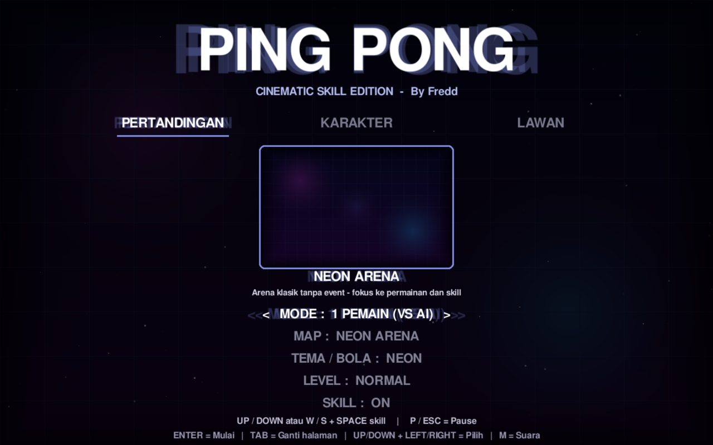
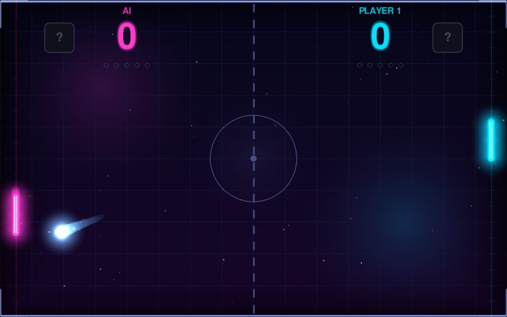

# 🏓 Ping-Pong Game — Cinematic Skill Edition

[](https://jamsutin.github.io/Ping-Pong-Game/)


Game ping-pong klasik yang dibuat lebih modern: efek sinematik, enam arena dengan event unik, karakter dan skin, serta tujuh kemampuan khusus dari **Mystery Box**. Bisa dimainkan melawan komputer atau berdua dalam satu keyboard.




> Proyek tugas sekolah. Ide dan konsep oleh **jamsutin**, dengan bantuan **Claude AI** sebagai asisten coding.

## 🎯 Pilih Cara Bermain

Ada **dua cara** memainkan game ini. Pilih sesuai kebutuhan:

| | 🌐 **Demo (di browser)** | 💻 **Full version (lewat kode)** |
|---|---|---|
| **Cocok untuk** | Mencoba cepat, tanpa instal apa pun | Bermain penuh dengan pengalaman terbaik |
| **Cara mulai** | Klik link, langsung main | Unduh kode, lalu jalankan dengan Python |
| **Butuh instal** | ❌ Tidak | ✅ Python + Pygame |
| **Suara & musik** | ❌ Tidak ada | ✅ Musik latar dan efek suara |
| **Performa** | Tergantung browser | Paling lancar |
| **Pengaturan tersimpan** | Tidak dijamin | ✅ Tersimpan di komputer |

---

## 🌐 Cara 1 — Main Demo di Browser (paling mudah)

1. Buka **<https://jamsutin.github.io/Ping-Pong-Game/>**
2. Tunggu sekitar 10–40 detik saat pertama kali. Browser sedang mengunduh mesin Python (±25 MB).
3. **Klik sekali pada area game** agar keyboard terbaca.
4. Tekan `ENTER` untuk mulai. Kontrol lengkap ada di [bagian Kontrol](#-kontrol-permainan).

> 💡 Demo berjalan di dalam browser lewat WebAssembly, jadi **tanpa suara**. Untuk musik, efek suara, dan performa terbaik, pakai Cara 2.

---

## 💻 Cara 2 — Full Version (jalankan lewat kode)

Cukup sekali pasang, setelah itu bisa dimainkan kapan saja tanpa internet.

### Langkah 1 — Pasang Python

Cek dulu apakah Python sudah ada. Buka **Command Prompt / Terminal**, lalu ketik:

```bash
py --version        # Windows
python3 --version   # macOS / Linux
```

Jika muncul nomor versi (3.9 atau lebih baru), lanjut ke Langkah 2. Jika belum, unduh Python dari <https://www.python.org/downloads/>.

> ⚠️ **Windows:** saat memasang Python, **centang "Add Python to PATH"** di layar pertama installer.

### Langkah 2 — Unduh game

**Cara termudah (tanpa Git):**

1. Di halaman repo ini, klik tombol hijau **Code** → **Download ZIP**.
2. Klik kanan file ZIP yang terunduh → **Extract All / Ekstrak**.
3. Buka folder hasil ekstrak sampai terlihat file `ping_pong_cinematic.py`.

**Atau pakai Git:**

```bash
git clone https://github.com/jamsutin/Ping-Pong-Game.git
cd Ping-Pong-Game
```

### Langkah 3 — Buka terminal di folder game

- **Windows:** di dalam folder game, klik kolom alamat folder, ketik `cmd`, lalu tekan `Enter`.
- **macOS / Linux:** klik kanan folder → *Open in Terminal*, atau gunakan `cd` ke folder tersebut.

### Langkah 4 — Pasang Pygame

Windows:

```powershell
py -m pip install -r requirements.txt
```

macOS / Linux:

```bash
python3 -m pip install -r requirements.txt
```

<details>
<summary>Opsional: pakai virtual environment (lebih rapi)</summary>

Windows:

```powershell
py -m venv .venv
.venv\Scripts\activate
py -m pip install -r requirements.txt
```

macOS / Linux:

```bash
python3 -m venv .venv
source .venv/bin/activate
python3 -m pip install -r requirements.txt
```

</details>

### Langkah 5 — Jalankan game 🎮

Windows:

```powershell
py ping_pong_cinematic.py
```

macOS / Linux:

```bash
python3 ping_pong_cinematic.py
```

Jendela game akan terbuka. Tekan `ENTER` untuk mulai.

> Gagal? Lihat bagian **Pemecahan Masalah** di bagian bawah halaman ini.

---

## ✨ Fitur

- Mode **1 pemain** melawan komputer dan mode **2 pemain** dalam satu keyboard.
- Pilihan karakter, skin, aksesori, dan nama pemain.
- Enam arena dengan event unik: Neon Arena, Jalan Raya, Gunung Volcano, Pasar Tradisional, Lab Kimia, dan Medan Perang.
- Tujuh kemampuan khusus melalui Mystery Box.
- Efek visual, animasi, dan latar arena yang dibuat murni lewat kode.
- Musik latar dan efek suara dibuat otomatis oleh program (tanpa file audio eksternal).
- Pengaturan permainan disimpan lokal di `ping_pong_settings.json`.

## 🧰 Teknologi

- Python 3 dan Pygame-CE
- Pygbag (WebAssembly) untuk versi browser
- GitHub Actions + GitHub Pages untuk build, tes, dan deploy otomatis

<details>
<summary><b>🛠️ Untuk developer: versi browser, build lokal, dan tes</b></summary>

Versi browser memakai `main.py` (pintu masuk Pygbag) dan `requirements-web.txt`. Versi desktop tetap `ping_pong_cinematic.py`.

Setiap Pull Request menjalankan workflow `Check browser game build`: tes statis, tes desktop, build Pygbag, lalu **tes browser Chromium sungguhan** (game harus mencapai frame pertama, menerima keyboard, dan bisa di-pause). Setelah digabungkan ke `main`, workflow `Build and deploy browser game` mengulang tes itu sebelum deploy, lalu menguji situs GitHub Pages yang sudah live.

Build lokal (Python 3.12 disarankan):

```bash
python -m venv .venv-web
source .venv-web/bin/activate        # Windows: .venv-web\Scripts\activate
python -m pip install -r requirements-web.txt
python -m pygbag .
```

Buka `http://localhost:8000` setelah server Pygbag siap.

Menjalankan tes:

```bash
python -m pip install pytest playwright
python -m playwright install chromium
python -m pytest tests/test_web_compat.py    # tes statis kompatibilitas browser
python -m pygbag --build .                   # build ke build/web
python tests/browser_smoke_test.py build/web # tes browser nyata
```

Catatan versi browser: modul `wave` tidak tersedia di Python WebAssembly Pygbag, `pygame.SCALED` dimatikan di browser, dan audio sintetis hanya aktif di desktop.

</details>

## 🎮 Kontrol Permainan

### Menu

| Tombol | Fungsi |
|---|---|
| `TAB` | Berganti halaman menu (pertandingan, karakter pemain, dan halaman karakter kedua/CPU sesuai mode) |
| `↑` / `↓` | Memilih baris menu |
| `←` / `→` | Mengubah pilihan |
| Ketik | Mengisi nama pemain |
| `ENTER` | Memulai permainan |
| `ESC` | Keluar dari game saat berada di menu |

### Mode 1 pemain

Pemain mengendalikan paddle di sisi kanan, sedangkan komputer berada di sisi kiri.

| Tombol | Fungsi |
|---|---|
| `↑` / `W` | Menggerakkan paddle ke atas |
| `↓` / `S` | Menggerakkan paddle ke bawah |
| `SPACE` | Menggunakan skill |
| `P` atau `ESC` | Pause |

### Mode 2 pemain (satu keyboard)

| Pemain | Tombol | Fungsi |
|---|---|---|
| Pemain 1 (kiri) | `W` | Bergerak ke atas |
| Pemain 1 (kiri) | `S` | Bergerak ke bawah |
| Pemain 1 (kiri) | `D` | Menggunakan skill |
| Pemain 2 (kanan) | `P` | Bergerak ke atas (bukan tombol pause) |
| Pemain 2 (kanan) | `L` | Bergerak ke bawah |
| Pemain 2 (kanan) | `K` | Menggunakan skill |
| Semua pemain | `ESC` | Pause |

### Tombol umum

| Tombol | Fungsi |
|---|---|
| `M` | Mengaktifkan / menonaktifkan suara |
| `F11` | Mengaktifkan / menonaktifkan fullscreen |
| `ENTER` | Bermain kembali setelah game over |
| `ESC` | Kembali ke menu setelah game over; saat pertandingan digunakan untuk pause sesuai mode |
| `Q` | Kembali ke menu dari layar pause |

**Target kemenangan:** pemain pertama yang mencapai 5 poin akan memenangkan pertandingan.

## 🧩 Kemampuan Khusus

Mystery Box dapat memberikan salah satu kemampuan berikut:

1. **Lightning Shot** — pukulan berikutnya menjadi tembakan petir yang sangat cepat.
2. **Za Warudo** — memperlambat gerakan lawan.
3. **Kagebunsin** — membuat klon paddle dengan gerakan terbalik.
4. **Nano Shield** — perlindungan sementara agar tidak kebobolan.
5. **Fish Throw** — melempar ikan untuk membuat lawan terkena stun.
6. **Light Speed** — meningkatkan kecepatan pemain sementara.
7. **Black Hole** — kemampuan langka yang dapat memenangkan ronde.

## 🗺️ Arena dan Event

| Arena | Event |
|---|---|
| Neon Arena | Arena standar tanpa event khusus |
| Jalan Raya | Kendaraan melintas dan dapat membuat pemain terkena stun |
| Gunung Volcano | Semburan lava dapat memperlambat pemain |
| Pasar Tradisional | Barang yang dilempar dapat menonaktifkan skill sementara |
| Lab Kimia | Botol racikan dapat membalik kontrol pemain |
| Medan Perang | Serangan proyektil dan bom dapat mengganggu pemain |

## 📁 Struktur Repository

```text
Ping-Pong-Game/
├── ping_pong_cinematic.py   # Kode utama permainan (versi desktop / full)
├── main.py                  # Pintu masuk versi browser (Pygbag)
├── requirements.txt         # Dependensi versi desktop
├── requirements-web.txt     # Dependensi untuk membangun versi browser
├── tests/                   # Tes otomatis (statis, desktop, browser nyata)
├── docs/                    # Screenshot untuk README
├── .github/workflows/       # Build, tes, dan deploy otomatis ke GitHub Pages
├── README.md                # Dokumentasi proyek
├── .gitignore               # File yang tidak perlu diunggah
└── ping_pong_settings.json  # Dibuat otomatis saat game menyimpan pengaturan
```

`ping_pong_settings.json` merupakan file pengaturan lokal yang dibuat oleh game. File tersebut tidak wajib diunggah ke repository.

## ⚙️ Penyimpanan Pengaturan

Pengaturan seperti nama, karakter, skin, dan map disimpan secara lokal di `ping_pong_settings.json`. Jika file belum ada, game akan membuatnya ketika diperlukan.

## 🛠️ Pemecahan Masalah

**Error `No module named 'pygame'`**

Pasang dependensi dengan:

```bash
py -m pip install -r requirements.txt
```

**Perintah `py` tidak dikenali**

Pastikan Python sudah terpasang dan masuk ke PATH. Pada macOS/Linux, gunakan `python3` sebagai pengganti `py`.

**Demo browser tetap hitam / tidak merespons**

- Tunggu 10–40 detik saat pertama kali dibuka; browser mengunduh mesin Python (±25 MB).
- Klik sekali pada area game agar keyboard terbaca.
- Gunakan Chrome, Edge, atau Firefox versi terbaru di laptop/PC. HP tidak didukung karena game memakai keyboard.
- Coba muat ulang halaman dengan `Ctrl + Shift + R`.

**Game tidak terbuka atau langsung berhenti**

- Jalankan game dari terminal agar pesan error terlihat.
- Pastikan terminal berada di folder yang sama dengan `ping_pong_cinematic.py`.
- Pastikan Pygame berhasil dipasang pada interpreter Python yang digunakan untuk menjalankan game.

## 👨‍💻 Kredit

- **Pengembang:** jamsutin
- **Asisten coding AI:** Claude AI
- **Jenis proyek:** Tugas sekolah / proyek pembelajaran pemrograman

Ide dan konsep proyek merupakan karya pengembang. AI digunakan sebagai alat bantu selama proses pengembangan.

---

Terima kasih telah mengunjungi repository ini. Selamat bermain! 🏓
